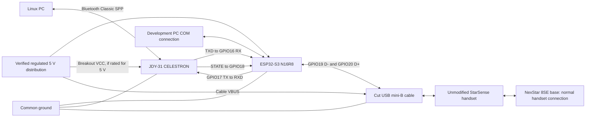

# Electrical connections

Use GPIO numbers printed on the board, not header positions counted from an
edge. The generic board's exact model and schematic have not been recorded.
GPIO16/17/18/19/20 worked on the tested board; another N16R8 board needs its own
pinout check. Wire everything with power removed.

The 5 V block is a logical power net, not a prescription to parallel external
power with PC USB. Follow [power.md](power.md) before energizing either source.

## JDY-31 to ESP32-S3

| JDY-31 terminal | Connect to | Purpose |
| --- | --- | --- |
| TXD | ESP32 GPIO16 | Module transmit → UART1 receive |
| RXD | ESP32 GPIO17 | UART1 transmit → module receive |
| STATE | ESP32 GPIO18 | High while Bluetooth connected, low while disconnected |
| GND | ESP32 GND / common ground | UART and power reference |
| VCC | Verified supply appropriate to the actual breakout | 5 V only for a breakout explicitly rated for it |
| EN / KEY, if present | Leave unconnected | Not driven by this firmware |
| CTS / RTS, if exposed | Leave unconnected | Current UART configuration has no hardware flow control |

All UART and STATE signals are **3.3 V logic**, regardless of breakout supply
voltage. TX and RX cross: TXD must go to GPIO16, not GPIO17. Do not use the COM
UART pins for the module. STATE is required by the bridge configuration, and
module-generated UART reports must also be disabled.

## Cut mini-B handset cable to ESP32-S3

The current assembly uses a **mini-B male plug at the handset**, with the cut
end soldered to the ESP32 headers. This connects directly to the S3's native
USB peripheral, bypassing the board's native connector mechanically.

| USB mini-B contact | Signal | Board connection / net | Typical cable color, identification only |
| --- | --- | --- | --- |
| 1 | VBUS | Verified host 5 V distribution / suitable board 5 V header | Red |
| 2 | D− | **GPIO19** | White |
| 3 | D+ | **GPIO20** | Green |
| 4 | ID | Unconnected | Often absent in cable |
| 5 | GND | ESP32 GND / common ground | Black |
| Shell / drain | Shield | No separate shield termination was recorded for this build | Bare drain / foil, if present |

**Identify contacts by continuity with power removed.** Cable colors are not
proof. Plug contact numbering can appear reversed depending on viewing
orientation; use a mini-B breakout or verified connector drawing rather than
assuming left/right. Insulate any unused ID or drain conductor.

These USB signals are **not TTL serial RX/TX**. Never connect handset D+/D−
to GPIO16/17, or handset VBUS to a 3V3 or battery rail. Do not use the native
USB connector for another USB data connection while this soldered cable is
attached: both routes share GPIO19/20.

Keep the USB pair short, together, with its original twist/shield as close to
the solder points as practical. Avoid long separated jumper leads and stubs.
Insulate joints and add strain relief so cable tension cannot pull header pads.

The working net list is also available as [connections.csv](connections.csv).
The exact physical 5 V header pad and final external power entry were not
recorded; identify them on the actual board using the power checks.
